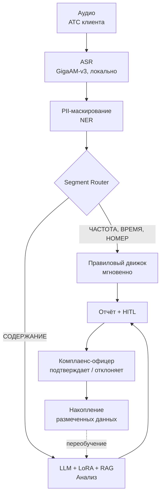

# Production Roadmap: от MVP до рабочей системы

MVP, описанный в основном README, — это **proof-of-concept**. Он доказывает, что конвейер ASR + LLM работает на синтетических данных в закрытом контуре. Но **для production на реальных данных клиента** требуется четыре дополнительных слоя.

---

## Почему MVP ≠ production

На синтетических сценариях, написанных вручную, Qwen2.5-7B показывает приемлемую точность. На **реальных звонках МФО** та же модель будет давать **много ложных срабатываний** — потому что:

1. **Специфика формулировок.** Каждая МФО имеет свои скрипты. Фраза «мы будем вынуждены обратиться в суд» в одной компании — стандартная процедура, в другой — форма давления. Модель без обучения не различит.

2. **Специфика нарушений.** В разных МФО — разные типы нарушений. Одна компания грешит на частоту, другая — на давление, третья — на третьих лиц.

3. **Специфика операторов.** Разные операторы используют разные формулировки. Без обучения модель не поймёт, что вежливое напоминание и давление — это разные вещи в контексте конкретной компании.

4. **Провокации должников.** Должники могут угрожать, оскорблять, давить. Модель может пометить ответ оператора как нарушение, хотя он защищался.

**Вывод:** без адаптации к данным клиента система будет давать много ложных срабатываний. Это не проблема архитектуры — это **фундаментальное ограничение** LLM общего назначения.

---

## Четыре слоя для production

### Слой 1: Fine-tuning на данных клиента (LoRA)

**Что делаем:**
- Комплаенс-офицер размечает **100–500 реальных звонков** клиента: где реальное нарушение, где нет.
- На этой разметке обучаем **LoRA-адаптер** для Qwen2.5-7B.
- LoRA занимает **~50 МБ** (не полный вес модели), обучается за **1–2 часа** на одной RTX 4090.
- После обучения модель **понимает специфику** конкретной МФО.

**Что это даёт:**
- Точность на реальных данных вырастает в разы.
- Ложные срабатывания снижаются.
- Модель начинает различать «стандартную практику» и «нарушение» в контексте клиента.

**Стоимость:** 1 разовая работа по разметке (10–20 часов комплаенс-офицера) + 2 часа обучения на GPU.

### Слой 2: RAG — база знаний клиента

**Что делаем:**
- Загружаем в векторную базу **скрипты, регламенты, внутренние правила** клиента.
- Для каждого звонка RAG подтягивает **релевантные правила** в промпт.
- Модель анализирует с учётом специфики клиента.

**Что это даёт:**
- Модель знает, что **считается нарушением** в конкретной компании.
- Можно **обновлять правила** без переобучения модели.
- Комплаенс-офицер видит, **на основании какого правила** найдено нарушение.

**Стоимость:** 1 разовая настройка RAG + поддержка базы знаний.

### Слой 3: HITL-цикл — накопление размеченных данных

**Что делаем:**
- Комплаенс-офицер **подтверждает** или **отклоняет** каждое найденное нарушение.
- Эти решения **накапливаются** в базе.
- Раз в квартал — **переобучение LoRA** на новых данных.

**Что это даёт:**
- Система **становится точнее** со временем.
- Каждое отклонение ложного срабатывания — это **обучающий пример**.
- Клиент видит **ROI** — точность растёт с каждым месяцем.

**Стоимость:** постоянный процесс (комплаенс-офицер работает в системе).

### Слой 4: Правиловый движок для детерминированных проверок

**Что делаем:**
- **Частота звонков** — правило, не LLM.
- **Время звонка** — правило, не LLM.
- **Номер звонящего** — правило, не LLM.
- LLM занимается **только содержанием** (давление, третьи лица, идентификация).

**Что это даёт:**
- Регуляторные числа **не галлюцинируются**.
- Детерминированные проверки работают **мгновенно** (без LLM).
- LLM разгружена для сложных задач.

**Стоимость:** 1 разовая разработка правилового движка.

---

## Итоговая архитектура production-системы

**Легенда:**
- **Сплошные стрелки** — поток данных.
- **Пунктирная стрелка** — цикл обратной связи (переобучение LoRA на накопленных данных).

---

## Что это значит для клиента

**MVP** (то, что описано в основном README) — это **демонстрация концепции**. Она показывает:
- Конвейер работает.
- Данные не покидают контур.
- Нарушения находятся.
- HITL встроен.

**Production** (то, что нужно внедрить) — это **рабочая система**. Она требует:
- **Пилота** на реальных данных клиента (2–4 недели).
- **Разметки** 100–500 звонков комплаенс-офицером.
- **Fine-tuning** LoRA на размеченных данных.
- **Настройки RAG** под регламенты клиента.
- **Интеграции** с АТС и CRM клиента.

**Срок внедрения:** 1–3 месяца от пилота до production.

---

## Почему я описываю это честно

Большинство ИИ-архитекторов продают **«готовое решение»** — и потом сталкиваются с реальностью: на данных клиента модель не работает. Я предпочитаю **честно разделить** MVP и production.

**Для клиента это значит:**
- **Никаких сюрпризов** после подписания договора.
- **Понятный roadmap** внедрения.
- **Реалистичные ожидания** по точности.

**Для меня это значит:**
- **Доверие** клиента.
- **Долгосрочные отношения** (fine-tuning, поддержка, обновления).
- **Позиционирование** как Fractional CAIO, а не как продавца коробки.

---

## Что запросить у клиента на этапе пилота

Для перехода от MVP к production-системе потребуется от клиента:

1. **Выборку реальных звонков** (100–500 штук) с разметкой нарушений. Разметку делает комплаенс-офицер клиента, я помогаю с методологией.
2. **Доступ к скриптам и регламентам** взыскания (для настройки RAG).
3. **Информацию об АТС и CRM** (для интеграции).
4. **Доступ к среде** (тестовый контур или on-premise сервер).
5. **Согласование ролей** (оператор ПДн, обработчик по поручению) с юридической службой.

**Что НЕ требуется:**
- Передача данных за пределы контура клиента.
- Отказ от текущей АТС или CRM.
- Остановка текущих процессов взыскания.

---

## Метрики успеха production-системы

| Метрика | Целевое значение |
|---------|------------------|
| **Recall (найдено реальных нарушений)** | ≥ 0.95 |
| **Precision (после HITL)** | ≥ 0.98 |
| **WER ASR на реальных звонках клиента** | ≤ 15% |
| **Время обработки одного звонка** | ≤ 60 секунд (батч) |
| **Покрытие аудита** | 100% |
| **Снижение времени до обнаружения** | с недель до ≤ 24 часов |

---

## Roadmap внедрения (примерный план)

| Этап | Длительность | Что делаем |
|------|--------------|-----------|
| **1. Пилот** | 2–4 недели | Разворачиваем MVP в контуре клиента, обрабатываем 100–500 звонков |
| **2. Разметка** | 2–3 недели | Комплаенс-офицер клиента размечает выборку, я помогаю с методологией |
| **3. Fine-tuning** | 1 неделя | Обучаем LoRA на размеченных данных, валидируем на golden set |
| **4. RAG** | 1–2 недели | Загружаем регламенты клиента, настраиваем retrieval |
| **5. Интеграция** | 2–4 недели | Подключаем к АТС и CRM, настраиваем батчевую обработку |
| **6. Production** | ongoing | Мониторинг, HITL-цикл, переобучение раз в квартал |

**Итого:** 1–3 месяца от старта пилота до production.
