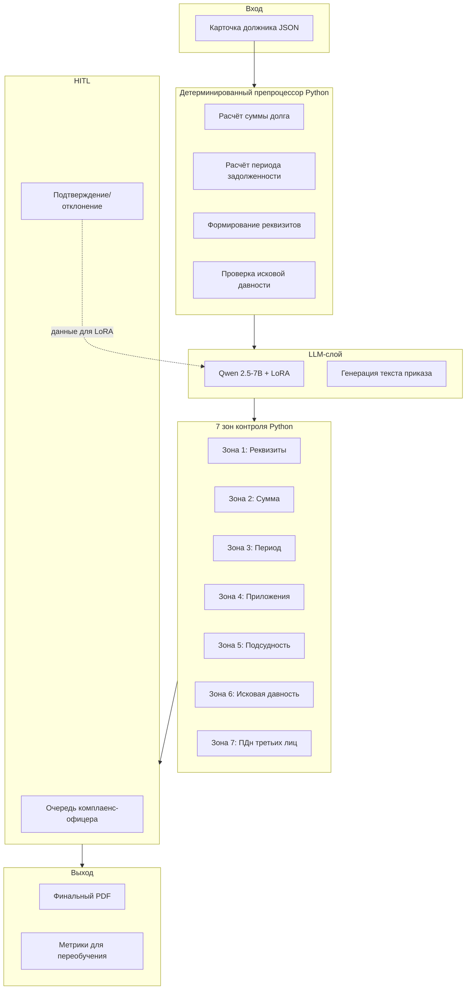

# Архитектура: ИИ-конвейер судебных документов

> Конвейер от карточки должника до готового судебного приказа.
> **Ключевой принцип:** LLM решает языковые задачи, детерминированный код — формальные.

---

## 1. Общая схема конвейера



**Текстовое представление:**

```
Карточка должника (JSON)
        │
        ▼
┌─────────────────────────────────────┐
│  Детерминированный препроцессор     │   ← Python
│  - расчёт суммы долга               │
│  - расчёт периода                   │
│  - формирование реквизитов          │
│  - проверка исковой давности        │
└──────────────┬──────────────────────┘
               │
               ▼
┌─────────────────────────────────────┐
│  LLM (Qwen 2.5-7B + LoRA)           │   ← Ollama
│  Генерация текста судебного приказа │
└──────────────┬──────────────────────┘
               │
               ▼
┌─────────────────────────────────────┐
│  7 ЗОН КОНТРОЛЯ                     │   ← Python
│  Зона 1: Реквизиты сторон           │
│  Зона 2: Сумма иска                 │
│  Зона 3: Период задолженности       │
│  Зона 4: Приложения                 │
│  Зона 5: Подсудность                │
│  Зона 6: Исковая давность           │
│  Зона 7: ПДн третьих лиц (LLM+код)  │
└──────────────┬──────────────────────┘
               │
               ▼
┌─────────────────────────────────────┐
│  HITL: очередь комплаенс-офицера    │   ← n8n Form / простой UI
│  - подтвердить                      │
│  - отклонить                        │
│  - отправить на доработку           │
└──────────────┬──────────────────────┘
               │
               ▼
        Финальный PDF
               │
               ▼
        Данные для переобучения LoRA
```

---

## 2. Компоненты

| Компонент | Технология | Роль | Порт |
|---|---|---|---|
| **Оркестратор** | n8n | Управление потоком, webhook, HITL-форма | 5679 |
| **LLM** | Qwen 2.5-7B через Ollama, INT4 (AWQ) | Генерация текста приказа | 11434 |
| **Препроцессор** | Python 3.10 | Расчёты, формирование реквизитов | — |
| **Правиловый движок** | Python 3.10 | 7 зон контроля | — |
| **HITL-интерфейс** | n8n Form | Подтверждение/отклонение | 5679 |
| **PDF-генератор** | Python (reportlab / weasyprint) | Финальный документ | — |
| **GPU** | RTX 4090 24 ГБ | LLM-инференс | — |

**Инфраструктура:** тот же сервер `chantelle` (Selectel), отдельный n8n-инстанс на порту 5679, общий Ollama.

---

## 3. Пять ключевых trade-offs

### Trade-off 1: LLM для текста, код для проверок

**Решение:** разделить задачи — LLM генерирует текст, код проверяет формальные требования.

**Альтернатива:** попросить LLM делать всё — и генерировать, и проверять.

**Почему выбрано первое:**
- LLM **ошибается в арифметике** — 7B-модель не считает надёжно.
- Формальные проверки (ИНН, ОГРН, даты) — детерминированы, LLM здесь даст шум.
- Юристу нужны **бинарные ответы** для формальных зон, а не «confidence 0.73».
- Каждое нарушение **объяснимо**: «правило Z-4 не нашло приложение „копия договора“».

**Цена:**
- Два слоя вместо одного — сложнее в разработке.
- Нужно писать и поддерживать Python-правила.

**Выигрыш:**
- Надёжность: правила работают 100% детерминированно.
- Объяснимость: каждое срабатывание обосновано.
- Безопасность: LLM не «выдумывает» нарушения.

---

### Trade-off 2: LoRA vs полный fine-tuning

**Решение:** **LoRA** (Low-Rank Adaptation) — лёгкая адаптация модели на данных клиента.

**Альтернатива:** полный fine-tuning 7B-модели.

**Почему LoRA:**
- **Обучается на 100–500 примерах**, а не на миллионах.
- **Требует меньше VRAM** — можно обучать на той же RTX 4090.
- **Быстро** — часы, а не дни.
- **Можно менять** — под каждого клиента свой LoRA-адаптер.
- **Контроль бэкдоров** — веса LoRA малы, их проще проверить через ModelScan.

**Цена:**
- Чуть меньше «глубина» адаптации, чем при полном fine-tuning.

**Выигрыш:**
- Каждый клиент получает **свою** модель без переобучения с нуля.
- Переключаться между клиентами — просто подменить LoRA-адаптер.

---

### Trade-off 3: HITL — архитектурный принцип, не опция

**Решение:** **каждый** сгенерированный документ проходит через комплаенс-офицера.

**Альтернатива:** автоматическая отправка в суд без HITL.

**Почему HITL обязателен:**
- **Юридические действия инициирует человек.** Подпись под иском — ответственность юриста.
- Автоматическая отправка = **юридический риск** для МФО.
- HITL-данные накапливаются и **используются для переобучения** LoRA.

**Цена:**
- Нельзя полностью автоматизировать процесс — узкое место остаётся человеческим.
- HITL-интерфейс надо разработать и поддерживать.

**Выигрыш:**
- Юридическая безопасность.
- Данные для улучшения модели (замкнутый цикл).
- **Соответствие 230-ФЗ и ГПК РФ.**

---

### Trade-off 4: Гибридная проверка ПДн (LLM + код) в Зоне 7

**Решение:** **LLM** ищет упоминания третьих лиц в тексте, **код** проверяет наличие согласий.

**Альтернативы:**
- **Только код** (regex-поиск ФИО и ролей из карточки).
- **Только LLM** (попросить модель найти нарушения).

**Почему гибрид:**
- **Чистый код** пропустит контекстные упоминания: «мама должника», «супруга», «поручитель по договору».
- **Чистая LLM** может выдумать нарушение («модель так решила»).
- **Гибрид** — LLM находит кандидатов (гибкость), код проверяет согласия (надёжность).

**Цена:**
- Два шага вместо одного.
- Нужно синхронизировать форматы вывода LLM и входа правил.

**Выигрыш:**
- Точность: контекст + формальная проверка.
- Объяснимость: каждое срабатывание обосновано.
- Соответствие 152-ФЗ: снижение риска утечки ПДн третьих лиц.

---

### Trade-off 5: Синтетические данные для MVP

**Решение:** **синтетические** 50 карточек должников + 50 эталонных приказов + 35 документов с внедрёнными багами.

**Альтернатива:** взять реальные данные клиента (обезличенные).

**Почему синтетика:**
- **Красная линия:** данные должников не покидают контур клиента. У тебя их нет и не должно быть.
- **Контроль над багами** — можно внедрить конкретные типы ошибок для демонстрации всех 7 зон.
- **Воспроизводимость** — репо собирается и работает без реальных ПДн.

**Цена:**
- Синтетика **не покрывает** реальное разнообразие документов.
- На пилоте потребуется **адаптация** правил и LoRA.

**Выигрыш:**
- Юридическая чистота: никаких реальных ПДн в публичном репо.
- Демонстрация **всех** 7 зон на контролируемых примерах.
- Быстрый старт: 50 карточек генерируются за час.

---

## 4. Эволюция от Кейса №1

| Аспект | Кейс №1 (аудит звонков) | Кейс №2 (судебные документы) |
|---|---|---|
| **Задача LLM** | Семантический анализ транскрипта | Генерация текста судебного приказа |
| **Роль правил** | Отложены в production-roadmap | **Реализованы с самого начала** (7 зон) |
| **HITL** | Принцип (комплаенс-офицер проверяет) | Принцип + **механизм** (очередь + форма) |
| **Разделение LLM/код** | 4 изолированные ветки LLM, правила — TODO | LLM для текста, код для проверок |
| **Данные** | Синтетика (5 WAV) | Синтетика (50 карточек + 35 багов) |
| **Метрика** | 4/5 (80%) на синтетике | 7 зон + 3–5% целевой возврат |

**Ключевой сдвиг:** в Кейсе №1 правила были **отложены** (сценарий 1 провалился именно поэтому). В Кейсе №2 правила — **центральный элемент** архитектуры. Это отражает эволюцию от «MVP для доказательства LLM» к «production-ready архитектуре».

---

## 5. Инфраструктура

**Тот же сервер, что Кейс №1:**

| Параметр | Значение |
|---|---|
| Сервер | Selectel, RTX 4090 24 ГБ, 16 vCPU, 64 ГБ RAM, 100 ГБ диск |
| ОС | Ubuntu 22.04 |
| Стоимость | 37,70 ₽/час (прерываемый) |
| Статус | заморожен (FROZEN) |

**Изоляция от Кейса №1:**

| Компонент | Кейс №1 | Кейс №2 |
|---|---|---|
| n8n | порт 5678 | порт 5679 |
| Ollama | порт 11434 (общий) | порт 11434 (общий) |
| Модель | `qwen2.5:7b` | `qwen2.5:7b` + LoRA-адаптер |
| Данные | синтетические WAV | синтетические JSON-карточки |
| Webhook | `/webhook/transcribe` | `/webhook/court-generate` |

**Почему общий Ollama:** экономия VRAM (одна загруженная модель вместо двух). LoRA-адаптер подключается поверх при генерации.

---

## 6. Что НЕ в этой архитектуре (production-слои)

| Слой | Зачем | Почему отложено |
|---|---|---|
| **RAG** | Подтягивание внутренних регламентов МФО | Нужен доступ к документам клиента |
| **Fine-tuning LoRA** на реальных данных | Адаптация под конкретную МФО | Нужен размеченный датасет клиента |
| **Интеграция с ГАС «Правосудие»** | Автоматическая подача | Юридическое согласование |
| **Multi-tenant** | Один инстанс на несколько МФО | Требует изоляции данных |
| **Мониторинг качества** | Отслеживание дрейфа модели | Нужен production-трафик |

Все слои — в `production-roadmap.md`.

---

## 7. Поток данных (пример)

**Вход:** карточка должника `case-00042`

```json
{
  "case_id": "case-00042",
  "respondent": {
    "fio": "Иванов Иван Иванович",
    "birth_date": "1985-03-15",
    "address": "г. Самара, Кировский район, ул. Ленина, д. 10, кв. 5",
    "inn": "631234567890"
  },
  "creditor": {
    "name": "ООО МФО «Пример»",
    "inn": "7712345678",
    "ogrn": "1157746123456"
  },
  "contract": {
    "number": "МФО-2024-12345",
    "date": "2024-01-15",
    "amount": 50000.00,
    "rate": 0.8,
    "end_date": "2024-02-15"
  },
  "payments": [],
  "period_start": "2024-02-16",
  "period_end": "2024-05-31",
  "filing_date": "2026-10-15"
}
```

**Выход:** JSON отчёт + финальный PDF

```json
{
  "case_id": "case-00042",
  "document_generated": true,
  "zones": [
    { "zone": 1, "status": "pass", "issues": [] },
    { "zone": 2, "status": "fail", "issues": [
      { "reason": "Сумма иска завышена на 15%" }
    ]},
    { "zone": 3, "status": "pass", "issues": [] },
    { "zone": 4, "status": "fail", "issues": [
      { "reason": "Отсутствует приложение «копия договора займа»" }
    ]},
    { "zone": 5, "status": "fail", "issues": [
      { "reason": "Подсудность не соответствует месту жительства" }
    ]},
    { "zone": 6, "status": "pass", "issues": [] },
    { "zone": 7, "status": "pass", "issues": [] }
  ],
  "summary": {
    "critical_issues": 3,
    "requires_hitl": true
  },
  "pdf_path": "/tmp/case-00042.pdf"
}
```

---

*Архитектура · Кейс №2 · Fractional CAIO / AI Architect Portfolio · 2026*
