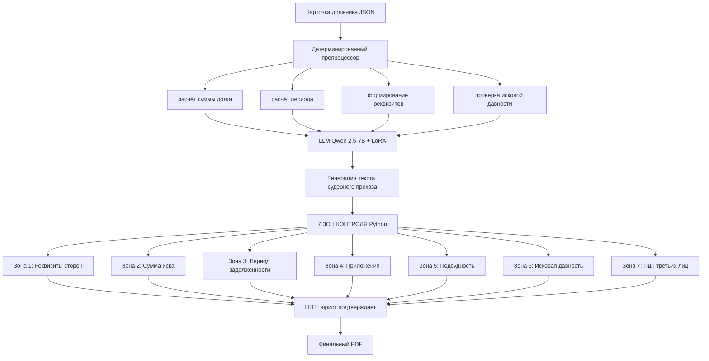

# Процесс: 7 зон контроля судебного документа

> Каждая зона — отдельный детерминированный модуль проверки.
> LLM генерирует текст, но **не** проверяет формальные требования — это делает код.

---

## Логика процесса



**Текстовое представление:**

```
Карточка должника (JSON)
        │
        ▼
┌─────────────────────────────────────┐
│  Детерминированный препроцессор     │
│  - расчёт суммы долга               │
│  - расчёт периода                   │
│  - формирование реквизитов          │
│  - проверка исковой давности        │
└──────────────┬──────────────────────┘
               │
               ▼
┌─────────────────────────────────────┐
│  LLM (Qwen 2.5-7B + LoRA)           │
│  Генерация текста судебного приказа │
└──────────────┬──────────────────────┘
               │
               ▼
┌─────────────────────────────────────┐
│  7 ЗОН КОНТРОЛЯ (Python)            │
│  Зона 1: Реквизиты сторон           │
│  Зона 2: Сумма иска                 │
│  Зона 3: Период задолженности       │
│  Зона 4: Приложения                 │
│  Зона 5: Подсудность                │
│  Зона 6: Исковая давность           │
│  Зона 7: ПДн третьих лиц            │
└──────────────┬──────────────────────┘
               │
               ▼
        HITL (юрист подтверждает)
               │
               ▼
        Финальный PDF
```

---

## Зона 1: Реквизиты сторон

**Что проверяем:**
- Истец: наименование, ИНН, ОГРН, адрес — соответствие карточке
- Ответчик: ФИО, дата рождения, место жительства, ИНН (если есть) — соответствие карточке
- Отсутствие опечаток в критичных полях

**Как проверяем (детерминированный код):**
- Сверка каждого поля с исходной карточкой должника
- Валидация формата ИНН (10 или 12 цифр, контрольная сумма)
- Валидация ОГРН (13 цифр, контрольная сумма)
- Проверка адреса по ФИАС/справочнику (упрощённая — на уровне формата)

**Что возвращает:**

```json
{
  "zone": 1,
  "status": "pass | fail | warning",
  "issues": [
    {
      "field": "respondent.inn",
      "expected": "771234567890",
      "found": "77123456789",
      "reason": "ИНН не соответствует контрольной сумме (неверная длина)"
    }
  ]
}
```

**Типовые баги (для синтетики):**
- Опечатка в ИНН/ОГРН
- Несовпадение адреса с карточкой
- Отсутствие одного из обязательных реквизитов

---

## Зона 2: Сумма иска

**Что проверяем:**
- Сумма иска в документе == расчётная сумма задолженности из препроцессора
- Сумма прописью == сумма цифрами (если есть пропись)
- Разбивка: основной долг + проценты + неустойка == итого

**Как проверяем (детерминированный код):**
- Сравнение числа из документа с числом из препроцессора (tolerance 0)
- Если в документе сумма прописью — парсинг прописью и сверка
- Проверка арифметики: `основной_долг + проценты + неустойка == итого`

**Что возвращает:**

```json
{
  "zone": 2,
  "status": "fail",
  "issues": [
    {
      "field": "claim_amount",
      "expected": 75000.00,
      "found": 86250.00,
      "difference": 11250.00,
      "reason": "Сумма иска завышена на 15% относительно расчёта"
    }
  ]
}
```

**Типовые баги:**
- Сумма в документе ≠ расчёт
- Ошибка в арифметике разбивки
- Сумма прописью ≠ сумма цифрами

---

## Зона 3: Период задолженности

**Что проверяем:**
- Период в документе == период из карточки
- Нет пропусков в периоде (дыр)
- Нет пересечений (дублирования)
- Конец периода ≤ дата подачи иска

**Как проверяем (детерминированный код):**
- Сравнение дат начала/конца
- Проверка непрерывности: `end[i] + 1 day == start[i+1]`
- Проверка: `end_period <= filing_date`

**Что возвращает:**

```json
{
  "zone": 3,
  "status": "fail",
  "issues": [
    {
      "field": "period",
      "found": "01.01.2024 — 31.03.2024",
      "expected": "01.01.2024 — 31.05.2024",
      "reason": "Пропущен период 01.04.2024 — 31.05.2024 (2 месяца задолженности)"
    }
  ]
}
```

**Типовые баги:**
- Пропуск периода (дыра)
- Пересечение периодов
- Конец периода в будущем

---

## Зона 4: Приложения

**Что проверяем:**
- Все обязательные приложения по ст. 132 ГПК РФ присутствуют:
  - Копия договора займа
  - Расчёт задолженности
  - Копия уведомления о взыскании (если требуется)
  - Выписка по счёту
  - Документ об уплате госпошлины
  - Доверенность представителя (если подача через представителя)
- Каждое приложение упомянуто в тексте документа

**Как проверяем (детерминированный код):**
- Проверка по чек-листу обязательных приложений
- Проверка: каждое приложение из списка есть в тексте
- Проверка: каждое приложение из текста есть в списке

**Что возвращает:**

```json
{
  "zone": 4,
  "status": "fail",
  "issues": [
    {
      "field": "attachments",
      "missing": ["Копия договора займа"],
      "reason": "Отсутствует обязательное приложение по ст. 132 ГПК РФ"
    }
  ]
}
```

**Типовые баги:**
- Отсутствие обязательного приложения
- Упоминание приложения, которого нет в списке
- Дублирование приложения

---

## Зона 5: Подсудность

**Что проверяем:**
- Суд в документе == суд по месту жительства ответчика
- Если ответчик — юрлицо: суд по месту нахождения
- Если есть договорная подсудность: суд по договору
- Соответствие подсудности требованиям ГПК РФ

**Как проверяем (детерминированный код):**
- Определение подсудности по адресу ответчика (справочник судебных участков)
- Сравнение с судом в документе
- Проверка договорной подсудности (если применимо)

**Что возвращает:**

```json
{
  "zone": 5,
  "status": "fail",
  "issues": [
    {
      "field": "court",
      "found": "Судебный участок № 123 Центрального района г. Москвы",
      "expected": "Судебный участок № 45 Кировского района г. Самары",
      "reason": "Иск подан не по месту жительства ответчика (ответчик зарегистрирован в Самаре)"
    }
  ]
}
```

**Типовые баги:**
- Суд не соответствует месту жительства ответчика
- Суд не соответствует договорной подсудности
- Пропущен судебный участок

---

## Зона 6: Исковая давность

**Что проверяем:**
- Не пропущен ли срок исковой давности (3 года по ст. 196 ГК РФ)
- Если пропущен: есть ли обоснование перерыва (признание долга, частичная оплата и т.д.)

**Как проверяем (детерминированный код):**
- Расчёт разницы: `filing_date - last_payment_date` или `filing_date - contract_end_date`
- Если > 3 лет: проверка наличия документов о перерыве срока
- Если перерыв есть: проверка дат перерыва

**Что возвращает:**

```json
{
  "zone": 6,
  "status": "warning",
  "issues": [
    {
      "field": "limitation_period",
      "days_since": 1245,
      "threshold": 1095,
      "reason": "Срок исковой давности превышен на 150 дней. Требуется обоснование перерыва (признание долга, частичная оплата)"
    }
  ]
}
```

**Типовые баги:**
- Пропущен срок исковой давности без обоснования
- Неверный расчёт даты начала срока
- Отсутствие документов о перерыве срока

---

## Зона 7: ПДн третьих лиц

**Что проверяем:**
- Нет ли в документе ПДн третьих лиц без согласия:
  - Поручители
  - Родственники должника
  - Совместные заёмщики
- Если третьи лица упомянуты: есть ли их согласие на обработку ПДн

**Как проверяем (гибридно):**
- **LLM** ищет упоминания третьих лиц в тексте (имена, роли, контекст)
- **Код** проверяет наличие согласий для каждого найденного лица
- **Код** проверяет, есть ли в карточке должника запись о согласии

**Что возвращает:**

```json
{
  "zone": 7,
  "status": "fail",
  "issues": [
    {
      "field": "third_party",
      "person": "Иванова М.П. (поручитель)",
      "reason": "В документе упомянут поручитель, но нет согласия на обработку ПДн. Нарушение 152-ФЗ."
    }
  ]
}
```

**Типовые баги:**
- Упоминание поручителя без согласия
- Упоминание родственника без согласия
- Упоминание совместного заёмщика без согласия

---

## Итоговая структура проверки

После прогона всех 7 зон формируется **сводный отчёт**:

```json
{
  "document_id": "case-00042",
  "checks": [
    { "zone": 1, "status": "pass", "issues": [] },
    { "zone": 2, "status": "fail", "issues": [] },
    { "zone": 3, "status": "pass", "issues": [] },
    { "zone": 4, "status": "fail", "issues": [] },
    { "zone": 5, "status": "fail", "issues": [] },
    { "zone": 6, "status": "warning", "issues": [] },
    { "zone": 7, "status": "pass", "issues": [] }
  ],
  "summary": {
    "total_zones": 7,
    "passed": 3,
    "failed": 3,
    "warnings": 1,
    "requires_hitl": true,
    "critical_issues": 3
  }
}
```

**Документ с `critical_issues > 0`** → уходит на HITL-проверку юристу.  
**Документ с `critical_issues == 0`** → идёт на подпись (тоже HITL, но быстрый путь).

---

## Распределение багов в синтетике

50 карточек должников:

| Тип бага | Зона | Кол-во |
|---|---|---|
| Неверные реквизиты | Зона 1 | 3 |
| Завышенная/заниженная сумма | Зона 2 | 4 |
| Пропуск в периоде | Зона 3 | 3 |
| Отсутствует приложение | Зона 4 | 5 |
| Неверная подсудность | Зона 5 | 4 |
| Пропущен срок исковой давности | Зона 6 | 3 |
| Утечка ПДн третьего лица | Зона 7 | 3 |
| **Комбинированные (2–3 бага)** | несколько | 10 |
| **Чистые документы** | — | 15 |
| **Итого** | | **50** |

**Для демо-видео** выбран один документ с **тройным багом:**
- Зона 2: сумма завышена на 15%
- Зона 4: отсутствует приложение «копия договора займа»
- Зона 5: неверная подсудность

Это покажет работу **трёх разных зон** в одном прогоне — визуально эффектно и демонстрирует полноту архитектуры.

---

*Процесс · Кейс №2 · Fractional CAIO / AI Architect Portfolio · 2026*
