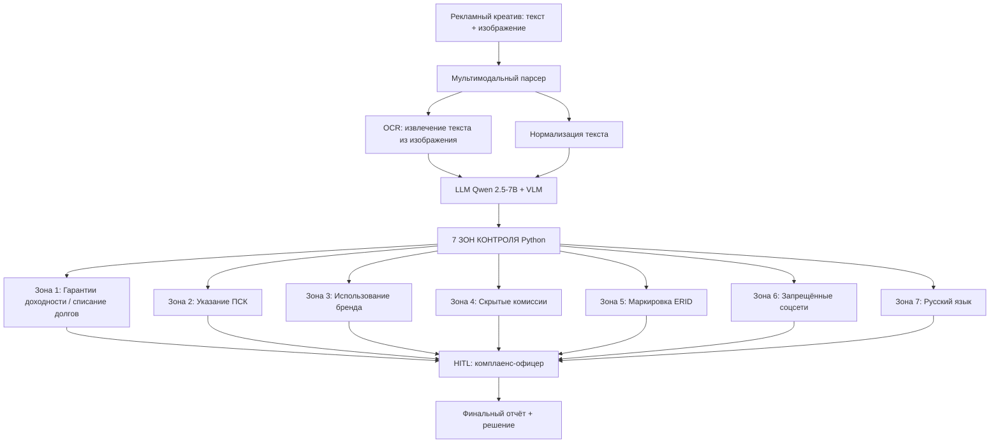

# Процесс: 7 зон контроля рекламных интеграций (ФАС)

> Каждая зона — отдельный модуль проверки.
> **LLM** ищет семантические нарушения, **код** — формальные.

---

## Логика процесса



**Текстовое представление:**

```
Креатив (текст + изображение)
        │
        ▼
┌─────────────────────────────────────┐
│  Мультимодальный парсер             │
│  - OCR (извлечение текста)          │
│  - Нормализация                     │
└──────────────┬──────────────────────┘
               │
               ▼
┌─────────────────────────────────────┐
│  LLM (Qwen 2.5-7B) + VLM            │
│  - Семантический анализ             │
│  - Поиск логотипов, ERID            │
└──────────────┬──────────────────────┘
               │
               ▼
┌─────────────────────────────────────┐
│  7 ЗОН КОНТРОЛЯ (Python)            │
│  1. Гарантии доходности             │
│  2. Указание ПСК                    │
│  3. Использование бренда            │
│  4. Скрытые комиссии                │
│  5. Маркировка ERID                 │
│  6. Запрещённые соцсети             │
│  7. Русский язык                    │
└──────────────┬──────────────────────┘
               │
               ▼
        HITL (комплаенс-офицер)
               │
               ▼
        Финальный отчёт
```

---

## Зона 1: Запрет гарантий доходности и «списания долгов»

**Норма:** ст. 5 ФЗ «О рекламе» (38-ФЗ), ст. 28.

**Что проверяем:**
- Запрет гарантировать доход/одобрение («одобрим 100%», «гарантированный доход»)
- Запрет обещать **«списание долгов»** и «финансовую свободу»
- Запрет гарантировать доходность инвестиций («зарабатывайте от 26%»)

**Как проверяем (LLM):**
- Промпт: «Найди в тексте фразы, которые гарантируют доход, одобрение или освобождение от долгов. Приведи цитату и объясни, почему это нарушение ст. 5 ФЗ «О рекламе».»

**Что возвращает:**

```json
{
  "zone": 1,
  "status": "fail",
  "issues": [
    {
      "field": "text",
      "quote": "Одобрим 100% даже с плохой кредитной историей",
      "reason": "Гарантия одобрения — недостоверная реклама (ст. 5 ФЗ «О рекламе»)"
    }
  ]
}
```

**Типовые баги:**
- «Гарантированный доход»
- «Списание долгов»
- «100% одобрение»
- «Финансовая свобода»

---

## Зона 2: Указание ПСК (полная стоимость кредита)

**Норма:** 353-ФЗ, ст. 6; ФЗ «О рекламе», ч. 3 ст. 28.

**Что проверяем:**
- Наличие фразы **«полная стоимость кредита (займа)»** полностью (не сокращение «ПСК»)
- Указание **диапазона значений** ПСК (если в рекламе есть процентные ставки)
- Достоверность и читаемость (шрифт, цвет — не вводят в заблуждение)

**Как проверяем (код + LLM):**
- **LLM** — ищет **наличие** фразы (или её отсутствие).
- **Код** — проверяет, что указан **диапазон** (например, «от 12% до 35%»).

**Что возвращает:**

```json
{
  "zone": 2,
  "status": "fail",
  "issues": [
    {
      "field": "text",
      "reason": "Указана ставка, но отсутствует фраза «полная стоимость кредита (займа)»",
      "expected": "полная стоимость кредита (займа) от X% до Y%",
      "found": "ставка 5%"
    }
  ]
}
```

**Типовые баги:**
- Указана только ставка, без ПСК
- Сокращение «ПСК» вместо полной фразы
- Нет диапазона (только «от 5%»)

---

## Зона 3: Использование бренда банка/МФО

**Норма:** ст. 5 ФЗ «О рекламе» (недостоверность), ст. 1484 ГК РФ (исключительные права на товарный знак).

**Что проверяем:**
- Использование логотипа/названия банка **без письменного согласия**
- Указание партнёра как «официального представителя» без подтверждения

**Как проверяем (VLM + LLM):**
- **VLM** — ищет **логотипы** банков на изображении.
- **LLM** — ищет **названия** банков в тексте (если есть — требует **подтверждения** согласия).

**Что возвращает:**

```json
{
  "zone": 3,
  "status": "warning",
  "issues": [
    {
      "field": "image",
      "reason": "На изображении найден логотип банка «X». Требуется подтверждение прав на использование."
    }
  ]
}
```

**Типовые баги:**
- Логотип банка без согласия
- Название банка в заголовке без согласия
- «Официальный партнёр» без подтверждения

---

## Зона 4: Скрытые комиссии и условия

**Норма:** п. 2 ч. 2 ст. 28 ФЗ «О рекламе».

**Что проверяем:**
- Умолчание о дополнительных платежах (страховка, комиссия за перевод)
- Указание только привлекательной ставки без остальных условий

**Как проверяем (LLM):**
- Промпт: «Проверь, указаны ли в тексте **все условия** (страховка, комиссии, сроки). Если указана только ставка — это нарушение.»

**Что возвращает:**

```json
{
  "zone": 4,
  "status": "warning",
  "issues": [
    {
      "field": "text",
      "reason": "Указана только ставка. Не указаны: страховка, комиссия, сроки."
    }
  ]
}
```

**Типовые баги:**
- Только ставка, без страховки
- Нет информации о комиссиях
- Нет сроков кредита

---

## Зона 5: Маркировка ERID (токен)

**Норма:** ст. 18.1 ФЗ «О рекламе»; п. 44 ст. 270 НК РФ (с 2026).

**Что проверяем:**
- Наличие токена **ERID** в креативе
- Валидность токена (через ОРД)
- Пометка **«Реклама»**

**Как проверяем (код + VLM):**
- **VLM** — ищет **пометку «Реклама»** и **токен ERID** (визуально).
- **Код** — проверяет **формат** токена (24 символа) и наличие в **белом списке** (если доступно).

**Что возвращает:**

```json
{
  "zone": 5,
  "status": "fail",
  "issues": [
    {
      "field": "image",
      "reason": "Отсутствует токен ERID. С 2026 года расходы без ERID не учитываются для налога (п. 44 ст. 270 НК РФ)."
    }
  ]
}
```

**Типовые баги:**
- Нет ERID
- ERID невалидный (не 24 символа)
- Нет пометки «Реклама»

---

## Зона 6: Реклама в запрещённых соцсетях

**Норма:** ФЗ № 236-ФЗ (о деятельности иностранных лиц), разъяснения ФАС.

**Что проверяем:**
- Размещение рекламы в **Instagram/Facebook** (принадлежат Meta, признанной экстремистской)
- Размещение на **заблокированных ресурсах** (реестр Роскомнадзора)

**Как проверяем (код):**
- Проверяем **домен** креатива (если ссылка) — есть ли в **чёрном списке**.
- Проверяем **метаданные** (если есть) — где размещён креатив.

**Что возвращает:**

```json
{
  "zone": 6,
  "status": "fail",
  "issues": [
    {
      "field": "placement",
      "reason": "Креатив размещён в Instagram (запрещённая соцсеть). Реклама незаконна."
    }
  ]
}
```

**Типовые баги:**
- Размещение в Instagram
- Размещение в Facebook
- Размещение на заблокированных ресурсах

---

## Зона 7: Русский язык (ФЗ-168)

**Норма:** ФЗ от 24.06.2025 № 168-ФЗ (в силе с 01.03.2026); ст. 3 ФЗ «О государственном языке».

**Что проверяем:**
- Использование **иностранных слов** в рекламе **без идентичного перевода** на русский язык
- Исключение: **зарегистрированные товарные знаки** (можно без перевода)

**Как проверяем (LLM + код):**
- **LLM** — ищет **иностранные слова** без перевода.
- **Код** — проверяет, является ли слово **зарегистрированным брендом** (если да — не нарушение).

**Что возвращает:**

```json
{
  "zone": 7,
  "status": "warning",
  "issues": [
    {
      "field": "text",
      "reason": "Найдено иностранное слово «cashback» без перевода. Требуется русский эквивалент (кэшбэк)."
    }
  ]
}
```

**Типовые баги:**
- Английские слова без перевода
- Латиница в заголовке
- Названия продуктов без русского перевода

---

## Итоговая структура проверки

После прогона всех 7 зон формируется **сводный отчёт**:

```json
{
  "creative_id": "creative-00042",
  "checks": [
    { "zone": 1, "status": "pass", "issues": [] },
    { "zone": 2, "status": "fail", "issues": [...] },
    { "zone": 3, "status": "warning", "issues": [...] },
    { "zone": 4, "status": "warning", "issues": [...] },
    { "zone": 5, "status": "fail", "issues": [...] },
    { "zone": 6, "status": "pass", "issues": [] },
    { "zone": 7, "status": "pass", "issues": [] }
  ],
  "summary": {
    "total_zones": 7,
    "passed": 4,
    "failed": 2,
    "warnings": 2,
    "requires_hitl": true,
    "critical_issues": 2
  }
}
```

**Креатив с `critical_issues > 0`** → уходит на HITL-проверку комплаенс-офицеру.

---

## Распределение багов в синтетике

30 креативов (текст + изображение):

| Тип бага | Зона | Кол-во |
|---|---|---|
| Гарантия доходности | Зона 1 | 4 |
| Отсутствие ПСК | Зона 2 | 4 |
| Логотип банка без согласия | Зона 3 | 3 |
| Скрытые комиссии | Зона 4 | 3 |
| Отсутствие ERID | Зона 5 | 4 |
| Реклама в запрещённых соцсетях | Зона 6 | 2 |
| Иностранные слова без перевода | Зона 7 | 3 |
| **Комбинированные (2–3 бага)** | несколько | 5 |
| **Чистые креативы** | — | 2 |
| **Итого** | | **30** |

**Для демо** выбран один креатив с **тройным багом:**
- Зона 1: «Гарантированный доход 30%»
- Зона 2: Нет ПСК
- Зона 5: Нет ERID

Это покажет работу **трёх разных зон** в одном прогоне.

---

*Процесс · Кейс №3 · Fractional CAIO / AI Architect Portfolio · 2026*
